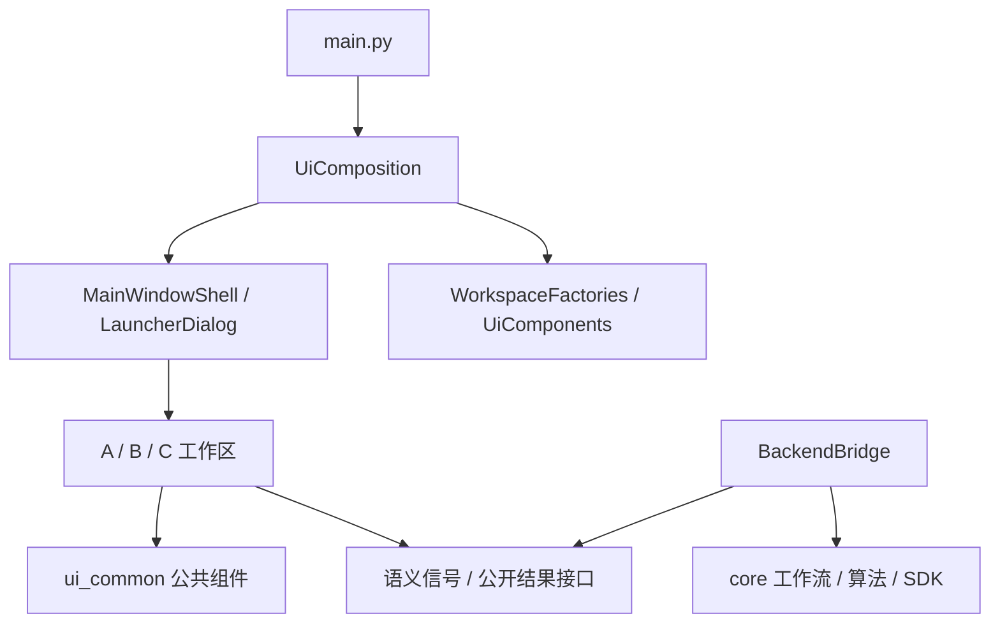

# UI 架构与替换指南

更新：2026-10-18；适用本地开发版 v1.10.0。

## 目标与当前边界

正式入口是 main.py → UiComposition → ui_v2 主窗口/工作区 → BackendBridge/业务工作流。
ui_common 维护与应用布局无关的预览、点云渲染、图标和线程原语。正式入口与 ui_v2/ui_common 均不导入旧 ui 包。

本轮不重做工业视觉，不修改标定、拼接、SDK 锁和保存门禁。旧 `src/ui` 源码、历史窗口和兼容转发已全部移除。工具和转台原型直接使用 `ui_common`；测试入口使用 UIv2 或核心离线服务。PyInstaller 显式排除 `ui` 包。

## 依赖方向



禁止 ui_common 反向导入 ui_v2；禁止 ui_v2 反向导入 ui。组件工厂要通过公开接口操作，控制器不得读取按钮名、布局索引或控件树。核心算法不得依赖 QWidget。

## 三个替换层级

| 改动目标 | 替换入口 | 无需改动 |
|---|---|---|
| 新布局/工作区 | WorkspaceFactories.multi / mobile / turntable | 业务槽函数与动作接线表，前提是新视图保持公开契约 |
| 2D 预览/3D 渲染器 | UiComponents.image_preview_factory / point_cloud_view_factory | A/B/C 工作区的数据回填逻辑 |
| 主窗口/启动器 | UiComposition.shell_factory / launcher_factory | 相机与算法核心，前提是实现相同窗口接口 |
| 主题和图标 | UiComposition.stylesheet / icons；公共组件 appearance | 业务动作、帧数据与保存机制 |

这是当前 A/B/C 的可替换装配层，不是任意模式的通用插件系统。新增模式仍需明确其工作流、会话与生命周期。

## 接入未来设计

项目根目录启动示例：

```python
from functools import partial
from main import main
from ui_v2 import UiComposition, UiComponents, WorkspaceFactories
from ui_v2.icons import DirectoryIconProvider
from ui_common.image_preview import AspectRatioLabel
from ui_common.point_cloud_viewer import EmbeddedPointCloudViewer
from ui_common.appearance import ImagePreviewAppearance, ViewerAppearance

# NewMultiWorkspace / NewMobileWorkspace / NewTurntableWorkspace
# 在新的 presentation 包内实现，保持本文列出的公开接口。
# 不必为了改布局而修改 BackendBridge 业务槽函数。
from my_design.workspaces import NewMultiWorkspace, NewMobileWorkspace, NewTurntableWorkspace

composition = UiComposition(
    workspaces=WorkspaceFactories(
        multi=NewMultiWorkspace,
        mobile=NewMobileWorkspace,
        turntable=NewTurntableWorkspace,
    ),
    components=UiComponents(
        image_preview_factory=partial(
            AspectRatioLabel,
            appearance=ImagePreviewAppearance(background="#161B22"),
        ),
        point_cloud_view_factory=partial(
            EmbeddedPointCloudViewer,
            appearance=ViewerAppearance(accent="#3BA6FF"),
        ),
    ),
    icons=DirectoryIconProvider("assets/industrial-icons", aliases={
        "camera": "capture.svg", "view_axes": "coordinate-axes.svg",
    }),
    stylesheet="...new application QSS...",
)
raise SystemExit(main(composition=composition))
```

`my_design` 为未来新设计的示例包名，本次没有创建它。只更换图标或外观时省略 workspaces，原有布局与业务接线继续使用。

工厂调用约定：

- 工作区接收 `parent=...`、`components=UiComponents(...)`。
- 图像组件接收 `ratio=...`、`parent=...`，返回实现 ImagePreview 协议的 QWidget。
- 点云渲染器接收 `parent=...`，返回实现 PointCloudView 协议的 QWidget。
- 主窗口接收 `parent`、`components`、`workspace_factories`、`launcher_factory`。
- 启动器接收 `parent`；初次启动和设备管理重开共用同一工厂。
- 工厂可直接返回新设计类，也可返回保持契约的适配器。不要让业务层根据控件 objectName 查找按钮。

## 业务动作契约

`src/ui_v2/bindings.py` 是 A/B/主窗口的动作接线入口。控制器先校验全部声明再连接，wire_all 重复调用不会重复绑定。

| 区域 | 视图发出的动作 |
|---|---|
| A | capture_requested(bool)、detect_requested(str)、calibrate_requested()、capture_scan_requested()、stitch_save_requested()、batch_scan_requested(int)、reference_changed(str)、step_back_requested(int)、单卡片 preview/capture/detect 信号；保留 save/load_extrinsics_requested |
| B | capture_station_requested()、preview_toggled(bool)、undo_requested()、recapture_requested(int)、delete_station_requested(int)、optimize_requested()、save_requested()、offline_load_requested()、station_selected(int) |
| 主窗口 | device_manager_reopened(str,list)、save_session_requested()、open_session_requested()、param_debug_requested()、session_save_finished(bool,str) |
| C | log_message(str,str)、dirty_changed(bool)、save_session_requested()；通过 set_background_runner 接收统一执行器 |

后端回填接口：

- A：set_devices / set_state / current_state；on_capture_done、on_detect_done、on_calibrate_done；clear_calibration_results、reset_camera_grid；current_detect_method、current_reference_id；viewer()、camera_grid()。
- B：set_devices / set_state / current_state；on_capture_done、on_detection_done、set_evaluation、on_evaluation_done、on_undo_done、on_recapture_done、on_optimize_done；set_stations、reset_session、get_station_id；viewer()、live_view()；is_preview_enabled()、set_preview_enabled(bool)。
- C：set_devices / set_state / current_state、set_camera_manager、set_background_runner、apply_loaded_calibration、load_sequence_frames。现有会话保存还访问 session 模型；布局完全重写时保留该模型适配，或在下一阶段将其提取为独立 presenter/workflow。
- 主窗口：workspace_multi/mobile/turntable、set_mode、current_mode、set_backend_bridge、log、show_loading/hide_loading、set_dirty 等；关闭前保存/等待语义必须保留。
- 启动器：refresh_requested、connect_requested、auto_ip_requested 信号；set_devices、selected_mode、selected_devices、restore_state，以及连接遮罩/忙状态相关公开方法。

不要把“工厂可替换”误解为任何 QWidget 都能零接线替换：新设计必须实现上述动作与结果接口。A/B 可在控件树不同的情况下复用接线表；C 仍有采集编排与显示逻辑共存，本轮未声称已完成完整 presenter 分离。

## 显示组件与数据

`contracts.py` 定义 ImagePreview 和 PointCloudView 的结构协议；创建时检查关键接口。

- ImagePreview：setPixmap、set_markers、clear_markers、clear_image。
- PointCloudView：点云增删、合并显示、参考系/高亮、点大小、视角、折叠/最大化；status_changed、collapse_toggled、maximize_toggled 信号。
- ViewerPanel 是稳定外观适配层，工作区调用它的公开方法；renderer_factory 可换其内部实现。
- 图像标记继续使用归一化显示坐标；红/绿/蓝的业务含义必须保留，可换视觉表现但不能悄悄换判据。
- 原始点云、显示采样数据与导出数据仍按原实现区分，不因 UI 迁移改变单位、坐标方向、过滤参数或 SDK 资源生命周期。

ImagePreviewAppearance 支持预览底色、边框、空状态文字色、标记色/半径；ViewerAppearance 支持查看器工具栏和容器外观。它们不是完整的 GPU 主题系统；OpenGL 场景色与更深的渲染变更可通过渲染器工厂接入。

## 图标设计交付约定

- 工作区调用语义名，如 camera、save、folder_open，不直接引用图标文件路径。
- 公共查看器保留 view_top/front/side/iso、view_axes、view_grid、theme、maximize、restore 等资源名，可通过 aliases 映射新素材。
- UiComposition.icons 接受 `(name, color, size) -> QPixmap | None` 的提供器；DirectoryIconProvider 支持 SVG/PNG 原色素材，文件缺项回退内置图标/原查看器资源。
- 目录提供器保持素材原色；需要按 color 染色时实现自定义提供器。
- 在 QApplication 创建后、控件构建前安装图标包；已创建控件持有图标快照，本轮不提供全控件热刷新承诺。
- 不需要改动现有 assets/icons，也不需要一次性交付全部图标。

## 迁移后的验证

```powershell
$MccPython = 'D:/Program Files/Anaconda/envs/rvc/python.exe'
Remove-Item Env:PYTHONPATH -ErrorAction SilentlyContinue
$env:QT_QPA_PLATFORM = 'offscreen'
$env:PYTHONIOENCODING = 'utf-8'
& $MccPython test_ui_architecture.py
& $MccPython src/ui_v2/smoke_test.py
& $MccPython test_ui_overlay.py
```

新增架构回归覆盖旧包导入拦截、A/B/C 显示组件替换、工作区替换后的动作分发、重复接线、图标提供器/目录素材、外观配置与实际 QThread 结果/退出信号。

历史 test_ui/test_integration/test_station 仍用于兼容路径与公共组件回归，不能代替正式 v2 的实机验收。本轮离线执行这些脚本时显式禁用了 PyRVC，以防真实相机初始化或连接。离屏检查不能证明 GPU、真实采集、多相机稳定性和打包 EXE 正常。

## 后续工业化重设计的建议顺序

1. 先交付统一的布局、字号、间距、状态语义与图标语义表。
2. 通过 composition 接入新主题、组件与 A/B 布局，保持业务动作和结果接口。
3. 将 C 的业务编排从工作区提取为 presenter/workflow，再替换 C 布局；保持 SDK 锁、临时帧释放、自动采集与保存语义。
4. 用同一套架构回归与真实数据/硬件验收新旧呈现，确认后再考虑删除历史界面与兼容入口。
