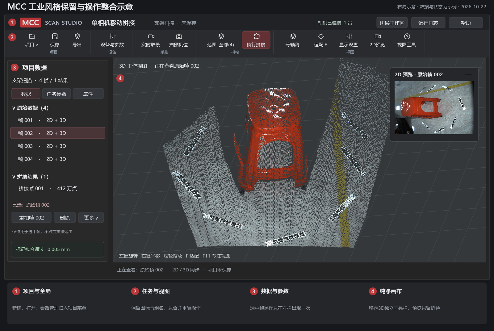
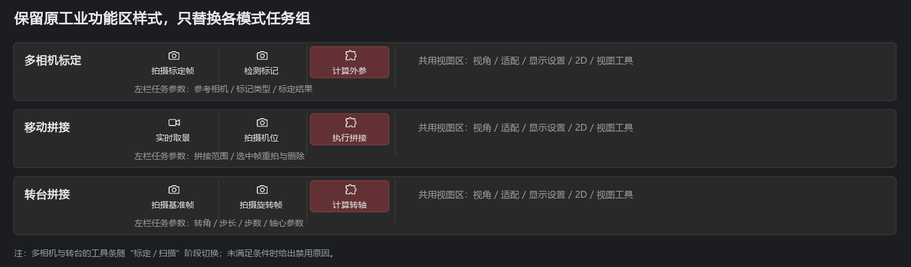

# MCC UI 通用操作整合与简化建议

日期：2026-10-22。核对基线：`MultiCameraCalibration` 分支、提交 `7b7b03c`、版本 `1.12.39`，以及当前工作区代码。本文件是设计建议，不表示正式 UI 已修改或相关能力已经实现。

根据用户补充要求，本方案必须保留现有工业风格。采用“原品牌状态头 + 原工业分组功能区 + 左侧数据与参数 + 中央画布”，仅优化操作位置、分组和逻辑。高频任务直接显示，低频设置放入有清晰名称的菜单，选中数据的操作集中在左侧。

### 设计保留约束

- 保留MCC红色标识、SCAN STUDIO品牌头、深灰底色、灰白线性图标与品牌红主操作，不改成另一套产品视觉。
- 顶部继续采用现有“图标在上、文字在下、组名在底部、竖线分组”的工业功能区。项目、设备、采集、拼接、视图的顺序及视觉语言保持熟悉，只归并冗余入口。
- 保留现有按钮边框、约4～5px小圆角、字体和密度；不使用上一版示意中的整排纯文字按钮替换工业图标功能区，不引入大圆角胶囊和大面积装饰卡片。
- 配色沿用 `industrial_ribbon.py`：品牌标识 `#b93638`、头部 `#202226`、功能区 `#292b2f`、主操作底色 `#633134`。实际实施复用原样式，不能根据示意图再写另一套近似主题。
- 左侧DB树、深灰3D场景和右上角可折叠2D预览继续保留。图中外部编号与说明仅用于讲解，不进入正式UI。

本轮优化是原工业界面的整理，不是风格重设计。以下迁移建议均服从上述约束。

## 一 布局示意

图中使用已有离线样例呈现点云/图像；项目名称、帧号、数量和门禁数值用于说明布局，不是本轮实测结果。按键只是示意，没有连接设备或执行任务。

多相机与转台图示为标定阶段。进入扫描阶段后，同一位置替换为扫描操作；转台自动采集中直接显示“停止采集”，不能藏入参数页或更多菜单。

## 二 当前复杂感来自哪里

目前不少顶部按钮已经通过 `CommandButton` 代理现有业务按钮，并会隐藏部分原按钮；并非每个视觉入口都重新连接了业务。问题主要是入口散落、语义相近、对象不够明确，以及低频操作与主流程占用相同空间。

| 现象 | 实际代码位置 | 对使用者的影响 |
|---|---|---|
| 两层顶部功能区，再叠加独立3D工具栏 | `industrial_ribbon.py`、`ui_common/industrial_viewer.py` | 项目、采集、点云显示设置在相邻但不同的操作带，难以判断归属 |
| 选择功能与设备管理都进入设备/工作区入口 | `IndustrialRibbon._build_mode()` | 两个名称看似做不同事情，实际路径接近 |
| DB底部同时有打开DB项目、返回工作视图、会话占用管理 | `FrameBrowser` | 与顶部打开会话、项目管理发生语义交叉，且挤占树的高度 |
| 删除原始帧可在顶部、DB按钮、右键菜单找到 | 移动模式功能区、`FrameBrowser` | 用户不容易判断“删除机位”和“删除DB数据”是否是同一个对象 |
| 重拍当前与撤销末帧放在一起但目标规则不同 | `ExplicitStitching` | 重拍跟随DB选择，撤销取最后原始帧，名称未充分呈现对象差别 |
| 拼接范围由选择数量隐式决定 | `ExplicitStitching.execute()` | 选中至少两帧拼接选中项，少于两帧使用全部原始帧；只选一帧时尤其容易误解 |
| 顶部执行拼接只以原始帧数量做初步门禁 | `IndustrialRibbon.update_status()` | 多相机还需要外参及扫描帧，转台还需要相应流程数据；按钮可点击但随后被业务拒绝 |
| 多相机有视图切换条、预览面板操作、每路预览按钮 | `IndustrialPresentation`、`CameraGrid` | 层次多，相机数量增加时重复按钮明显增多 |
| 旧版操作栏虽然默认折叠，展开后仍是一套操作区 | `IndustrialPresentation` | 新旧入口并列造成“应该点哪套”的疑问 |
| 质量、连接、当前帧、阶段、日志提示分布在多处 | 主窗口、功能区、DB底部、画布 | 重复信息与不同口径的信息混在一起；如标记拟合误差不能当成表面精度 |

### 当前界面抽查数量

使用离屏Qt创建1600×1000新版窗口，给多相机配置两路测试描述，移动/转台配置一路，不创建后端、不初始化SDK。统计 `isVisible()` 且具有非空文字的 `QAbstractButton`：

| 初始工作区 | 可见有文字按钮 |
|---|---:|
| 多相机，两路 | 40 |
| 移动拼接，一路 | 26 |
| 转台，一路 | 28 |

此计数包含禁用按钮和折叠按钮，不包含下拉框、数值框、树节点、菜单内动作及仅图标按钮；不是全部业务状态的最终数量。原始清单位于 `D:/RVC_SRC/.verify_reports/mcc-ui-proposal-20261022/visible-buttons.json`。据此判断入口密度，不用它宣称操作效率已提高某个百分比。

## 三 推荐的固定分区

| 分区 | 放什么 | 不放什么 |
|---|---|---|
| 顶部第一行，原品牌状态头 | MCC标识、SCAN STUDIO、当前工作区、项目名/未保存状态、连接状态、切换工作区、日志、帮助 | 大量业务按钮、每帧重拍/删除、点大小 |
| 顶部第二行，原工业分组功能区 | 按项目、设备、采集、拼接、视图分组；保留图标文字按钮与底部组名，显示当前模式任务及明确的拼接范围 | 大批标定参数、磁盘清理、会话列表、另一套纯文字导航条 |
| 左侧，数据与参数区 | 项目树、原始帧/标定数据/结果、数据/任务参数/属性页、选中数据操作、精简质量信息 | 另一套项目打开/保存按钮、与顶部重复的执行拼接 |
| 中央，3D画布 | 点云、必要标注、当前查看对象；保留可折叠2D预览 | 独立整排3D工具栏、重复任务操作、常驻大段操作说明 |
| 底部，统一状态条 | 当前任务/失败原因、查看对象、一次简短质量摘要；日志按需展开 | 另起一套任务控制按钮、同一指标的重复长文本 |

品牌头显示当前状态，工业功能区执行项目与任务操作，左侧操作当前数据。这样位置和作用对象形成稳定对应关系。菜单与快捷键可以保留同一动作的访问方式，但默认画面中不再多处常驻相同按钮。

### 空间建议

- 以1600×1000为示意：保留约48～52px品牌头和约80～86px工业功能区，状态区约28px，左栏约300～340px，可拖动调宽。不能为了省高度把现有图标功能区改成44px纯文字条。
- 1366×768优先缩短项目标题、把低频动作移入具名菜单；左栏内部滚动。不能靠减小字号、压扁输入框或覆盖DB底部按钮来适配。
- 窄窗口先收起2D预览内容，保留“2D预览”顶部开关；视图菜单仍可打开预览。不能把采集/停止和质量失败原因挤出窗口。
- “专注视图”只临时隐藏左栏及预览，不改变任务、选择和数据；退出恢复原尺寸。建议采用F11，避免与当前F/Z适配冲突。

## 四 按钮与公共组件迁移清单

| 当前入口 | 建议位置或呈现 | 操作逻辑建议 | 优先级 |
|---|---|---|---|
| 选择功能 | 顶部工作区选择 | 与设备管理区分概念；切工作区仍保留各草稿及未保存门禁 | P1 |
| 新建会话、打开会话 | 顶部“项目”菜单 | 打开正式会话与导入旧数据用清楚的条目；不能把DB索引当完整会话 | P1 |
| 保存会话 | 顶部固定“保存” | 有未保存标识；保存中避免重复提交，成功再清理dirty状态 | P1 |
| 导出点云 | 顶部固定“导出”菜单 | 明确目标结果名称；原始帧选中时不得暗中导出另一结果。无有效结果时禁用并给原因 | P1 |
| 打开DB项目、会话占用管理 | 项目菜单中的“导入数据”“会话管理” | 入口整合但保留语义边界；删除已保存会话/永久清理仍须确认 | P1 |
| 返回工作视图 | 左栏出现“正在查看历史数据”时的上下文条目，另保留右键 | 不常驻占一整行；返回前说明将恢复哪个工作视图 | P1 |
| 拍摄、检测、标定、拼接 | 顶部第二行的模式任务区 | 每阶段最多突出一个主动作，其他常用动作直接保留；只提示建议下一步，不自动执行设备操作 | P1 |
| 执行拼接范围 | 主按钮左侧，具名下拉 | 显式“全部原始帧（N）/仅选中帧（N）”；不足两帧直接禁用，不因只选一帧而静默回退到全部 | P1 |
| 重拍当前 | 左栏选中原始帧操作条 | 显示“重拍帧002”；必须恰好一帧、相机在线且无冲突任务；结果/组/多选不提供重拍 | P1 |
| 删除机位、DB删除按钮 | 左栏合并为“删除所选数据” | 单选、多选、分组、结果分别给目标与数量；移动模式仍清空旧配准并标记关联结果过期 | P1 |
| 撤销末帧 | 左栏“更多”菜单 | 改为“移除最后原始帧（004）”，避免被理解为通用撤销；与“恢复上次删除”分开 | P1 |
| 旧版操作栏 | 高级菜单“经典操作面板” | 默认不出现在左栏底部；迁移前保留原功能，不能直接删掉唯一仍可访问的高级设置 | P1 |
| 等轴测/顶视等 | 顶部右侧视角下拉 | 显示当前视角；状态与渲染器一致，切换模式不重复创建菜单 | P1 |
| 适配视图 | 顶部右侧固定“适配 F” | 合并旧顶部与3D独立工具栏的适配入口；F/Z仍可用 | P1 |
| 质量、颜色、点大小、网格、坐标轴、标记编号 | 顶部“显示设置”面板 | 一次打开可调整多个选项；改变显示不改变原始数据。质量菜单明确是渲染质量 | P1 |
| 最大化、截图 | 顶部“视图工具” | 名称“专注视图”避免与操作系统最大化混淆；截图能明确仅画布/含2D预览 | P2 |
| 全部预览、停止全部、单路预览 | 顶部任务区“实时取景”附属菜单 | “全部/指定相机”显式选择；顶部状态明确当前预览路数。多机诊断仍可从相机列表切单路 | P2 |
| 2D布局、裁边、冻结、保存图像 | 顶部2D预览菜单 | 图像面板只保留标题与折叠；冻结必须有明显标识且说明相机仍可能继续采集 | P2 |
| 每路3D拍、检测 | 多相机“任务参数/相机”页的选中相机操作，或高级诊断入口 | 全部采集为主流程；保留必要的单路故障排查能力，不擅自把所有设备串成一个同步操作 | P2 |
| 编码圆数据、详细质量、外参矩阵 | 左侧“属性/质量详情” | 数据与详情选中对象保持一致；画布标签显示可整体开关 | P1 |
| 定位轴心、显示旋转轴与中心 | 转台任务参数页；显示开关并入显示设置 | 定位是视图操作，修改轴心是参数操作；两者名称和权限分开 | P2 |
| 参数调试 | 顶部“设备与参数”的独立页签 | 设备连接、曝光采集参数、标记识别参数分别分组；不自动修改网络或设备模式 | P2 |
| Loading、后台进度、错误提示 | 共用Loading + 统一任务状态 | 继续使用已有Loading组件；必须完成任务按现有关闭等待规则处理，不额外创造取消按钮 | P1 |

P1表示优先做布局、命名与明确目标，P2表示在P1稳定后再收敛更复杂的呈现。它们是本建议的实施顺序，不是已确认产品缺陷的严重度。

## 五 三种模式的任务逻辑

### 多相机

左栏任务页保留“参考相机、标记类型、采集参数、标定质量、外参详情”。顶部任务区用明确的“标定/扫描”阶段切换控制显示内容：

- 标定：拍摄标定帧 → 检测标记 → 计算外参；失败时就地给原因，必要的重拍仍可直接操作。
- 扫描：拍摄扫描帧 → 执行拼接；批量拼接作为采集菜单选项。
- 只有外参及质量门禁满足时才进入扫描；不能只依据DB原始帧数量启用拼接。

首批不要把三步强行合成一个“自动标定”按钮。以后如增加向导，须明确将执行哪些相机操作、失败停在哪一步；专家模式仍能单独检测和核对外参。

### 移动拼接

顶部固定“实时取景、拍摄机位、拼接范围、执行拼接”。拍摄先保存原始数据，显式拼接生成独立结果，继续保留当前产品语义。

左栏只负责当前选择的重拍/删除/属性。选择状态与拼接范围是两个不同概念：改变选择不偷偷改变已显示的范围；建议默认全部原始帧，用户选择“仅选中”后才使用选中集合。两项选择都应在执行前核验帧仍存在且为原始帧。

质量摘要显示“最终标记拟合误差”，详细页解释其不等于整体点云表面精度；旧结果一旦因源帧变更而过期，数据树与导出门禁同步变化。

### 转台

标定阶段把 `frame0/frame1` 改为“基准帧/旋转帧”，角度和转轴设置放左栏；顶部保留两次拍摄与计算转轴。扫描阶段顶部切为“单步采集、自动采集、执行拼接”。

自动采集时，任务区直接替换出“停止采集”及当前步数，其他冲突操作禁用并说明原因。“停止”应指等待当前在途操作完成后的安全停止，不能承诺底层SDK即时中断，也不能由视图最大化/隐藏触发设备停止。

## 六 数据选择和当前视图必须说清楚

1. 点击原始帧行：明确同步其2D和3D。点击PLY子项：仅切3D。点击图像子项：可保留当前3D，但必须显示“2D：帧002 / 3D：拼接结果001”，不能只写“当前帧002”。
2. 选中结果：隐藏重拍，显示结果属性及来源帧；结果没有对应真实曝光，不默认挂上一张相机图像。
3. 选中分组/项目：显示范围和数量。删除按钮先展示将影响哪些记录；未选中数据时不显示虚假的“当前帧”目标。
4. 多选：显示“已选N帧”，将不适用操作禁用。保留右键操作的可发现性，右键改变选择不能意外启动异步预览。
5. 清空、载入、重拍后失效的图像、标记、点云和旧异步结果同时清理，继续使用选择token和渲染请求序号保护。

这些逻辑比把相同按钮搬到一个区域更能降低误操作。

## 七 公共组件如何组织

| 建议组件 | 职责 | 复用或修改位置 |
|---|---|---|
| 全局项目操作区 | 项目菜单、保存、导出、设备入口 | `IndustrialRibbon`、`SessionProjects`、`ExplicitStitching.export()` |
| 模式任务区 | 固定位置、模式/阶段动作集合及范围提示 | `IndustrialRibbon`、`bindings.py`、各workspace现有动作接口 |
| 视图操作区 | 视角、适配、显示设置、2D入口、视图工具 | 从 `IndustrialViewer` 提取工具栏；`ViewerPanel` 维持画布适配 |
| 数据选择操作条 | 目标名称、重拍、删除、更多 | `FrameBrowser`、`FrameDatabaseController`、`ExplicitStitching` |
| 左栏参数/属性容器 | 按模式与选择装入现有面板，不再复制实现 | `IndustrialPresentation` 的挂载/恢复逻辑 |
| 统一任务状态 | 忙状态、失败原因、Loading与必要进度 | `MainWindowShell`、`BackendBridge._run_background()`、`ui_common.loading` |

首批直接复用现有CommandButton、信号、控制器和服务，不复制一套按钮事件处理。中期可把公共操作收口为 `QAction/Command`：一个动作只连接一次业务，顶部/菜单/快捷键共享该动作及启用原因。不能同时保留旧clicked回调与新增triggered回调，导致一次点击执行两次。

显示设置应有每个工作区自己的状态对象，两个入口共用同一值；GPU/软件回退、切经典/工业呈现后能恢复。顶栏按钮不能长期捕获已经退休的canvas，改用ViewerPanel当前渲染器转发；信号回填用阻断机制避免循环触发。

## 八 分批实施建议

| 批次 | 交付范围 | 先验收什么 |
|---|---|---|
| A 入口归并 | 项目菜单、DB底部低频入口迁移、选中数据操作条、准确命名 | 保存/打开/删除/重拍一次分发，目标不含糊；不改存储格式 |
| B 公共视图操作 | 将3D独立工具栏接到顶部，统一显示设置与2D工具 | 切模式、切渲染器、软件回退后状态正确；点云数据不变 |
| C 模式阶段收敛 | 明确标定/扫描、拼接范围及更准确的启用原因 | 多相机/移动/转台成功与失败路径都可操作；停止始终可见 |
| D 清理迁移入口 | 将旧操作栏降为高级入口，必要单路诊断仍可访问 | 所有旧功能均有去处，再移除重复控件；不影响经典入口 |

建议先做A与B，评估一轮实际使用后再做C。不要一次重写全部布局、会话逻辑和设备服务。

## 九 验收清单

- 1600×1000、1366×768及缩放后的标题、工具区、DB树和底部状态不重叠；左栏滚动而非画布被按钮挤压。
- 三模式切换、经典/工业切换不丢当前草稿、视图参数、选择和2D预览状态。
- 单击保存、采集、删除、重拍、拼接都只触发一次后台操作；忙状态、成功和异常后的门禁正确恢复。
- 无相机、相机断线、离线会话、无原始帧、无外参、选择一个/多个/分组/过期结果均有准确的可用性与原因。
- 自动转台采集时停止可直接访问，显示设置仍可使用；不能因收起面板而停止或继续意外采集。
- 显示质量、颜色、点大小、视角等只改变显示；原始点云及显式保存策略不变。
- 加载失败、保存失败、取消、关闭时仍遵守原有线程和数据生命周期；不新增隐式自动保存或“取消即中断SDK”的承诺。
- 键盘焦点、菜单可达性、快捷键和工具提示可用；快捷键仅建议保存Ctrl+S、适配F/Z、专注F11，最终实现须核查现有冲突及文本输入焦点。

建议回归入口：`test_ui_architecture.py`、`test_ui_ribbon.py`、`test_ui_multicam_views.py`、`test_ui_industrial.py`、`test_ui_launcher.py`、`test_explicit_stitching.py`、`test_ui_frame_database.py`、`test_ui_session_projects.py`、`test_ui_offline_preview.py`、`test_loading_component.py`。这些是实施阶段的验收建议；本轮没有修改正式UI，也没有把以前测试结果当成本方案已经验收。

## 十 本轮交付与核验

交付本建议、整体布局图、三模式任务区图及可重建图示的脚本 `ui_review/20261022-ui-simplification/build_diagrams.py`。图示为静态布局，不提供真实业务交互。

已完成当前三模式代码核对、初始界面离屏截图与文字按钮清单统计；已渲染并检查建议图的中文、空间、文字归属和选择对象一致性。图示重建使用本机rvc Python与Qt；存在离线样例缓存时载入其点云/图像，仅抽样用于图示，不修改样例。

未修改src、未启动相机SDK、未进行真实设备动作或产品UI重排；因此本轮仅提交独立设计文档与图示，不升产品版本。后续真正修改按项目版本规范与上述分批验收执行。
