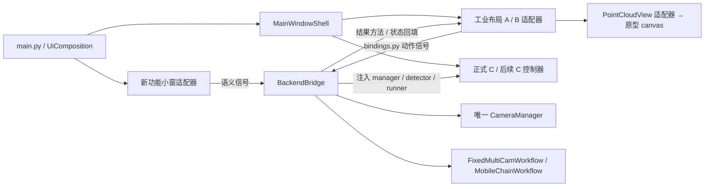

# 工业扫描原型 UI → 主程序迁移接线说明

日期：2026-10-19。核对目录：`D:/RVC_SRC/Python/MultiCameraCalibration`；分支 `MultiCameraCalibration`，HEAD `c456fad`，以本地工作树为准。

本次只新增本文档，没有修改代码、启动 SDK、连接相机或运行扫描。下文“现有”来自静态源码核对，“建议/待补”属于后续实施设计，不能当作已经接通或验收通过。

## 1. 结论与范围

迁移对象为 `prototypes/industrial_scan_ui`：功能选择小窗、多相机 2D 网格、移动链式大 3D 视区、转台标定侧栏、项目树、帧质量卡、编码圆查看和底部日志。正式宿主是 `main.py → UiComposition → MainWindowShell → BackendBridge`。

**建议保留正式设备与工作流链路，把原型布局包装成满足正式接口的 A/B 工作区；C 先保留正式采集编排，再拆出控制器接新布局。** 原型目前不能直接填写进 `WorkspaceFactories`：构造参数、动作信号、结果方法、状态值、相机 ID、会话对象和渲染协议均存在差异。

| 部分 | 当前原型能力 | 正式迁移口径 |
|---|---|---|
| 功能选择 | FunctionRegistry 动态注册三种布局，支持离线进入 | 首期映射正式 A/B/C；注册第四项不等于主程序自动支持第四种业务 |
| 设备 | DeviceService 可枚举、连接、刷新真实 2D | 正式运行由 BackendBridge 的 CameraManager 统一持有 |
| A 多相机 | 读取图像/检测 JSON，调用 CalibrationEngine 计算离线外参 | 接正式拍摄→检测→标定→锁定→扫描→保存完整链路 |
| B 移动链 | 目前 MobileWorkbench 只继承布局，扫描生成合成点云 | 接 MobileChainWorkflow 的采集、评估、入链、撤回、重拍、优化 |
| C 转台 | 两帧离线标定、采集间隔信号；扫描仍为模拟 | 接正式 TurntableWorkspace 的真实采集、序列与拼接编排 |
| 保存 | 可见图层 PLY 导出；没有完整项目恢复 | 区分点云导出、外参保存、OfflineSession 会话保存 |
| 显示 | GPU/软件 canvas，按帧缓存和显示预算 | 经渲染适配器实现 PointCloudView；保留完整原数据 |

其他原型（后处理 v2、机器人变换、双目重建）不属于本轮工业布局替换的默认接线范围。不能因布局迁移顺手并入。`src/ui_v2/README.md` 的“空壳”描述已落后于代码，当前架构以 `docs/UI架构与替换指南.md`、`bindings.py` 和实际调用为准。

## 2. 接线总图与所有权

| 资源/数据 | 所有者 | 新 UI 的职责 |
|---|---|---|
| SDK、相机句柄、检测锁、预览线程 | BackendBridge / CameraManager | 发意图、显示结果；不另建 DeviceService |
| A 标定帧、扫描帧、外参与质量门禁 | FixedMultiCamWorkflow / CalibrationEngine | 显示步骤、相机对表、撤板提示和按钮门控 |
| B 站位、链变换与累计误差 | MobileChainWorkflow / station_manager | 项目树映射 station_id，显示评估结果 |
| C 标定、序列、临时帧资源 | 当前正式 TurntableWorkspace / session | 第一阶段保留；后续控制器化后再接新视图 |
| 后台任务引用和退出等待 | BackendBridge._run_background / cleanup | 统一注入；不建立第二套业务线程池 |
| GPU 缓存、视角、显示预算 | canvas / 渲染适配器 | 清理 GL 资源，采样只影响显示 |
| 正式保存状态 | 主窗口 + 工作流 | 成功保存回执后才清 dirty；显示导出不冒充会话保存 |

## 3. 装配接口：在哪换 UI

接入入口：`src/ui_v2/composition.py`、`components.py`、`contracts.py`。

| 注入点 | 要求 | 原型差异/处理 |
|---|---|---|
| WorkspaceFactories.multi/mobile/turntable | 工厂接受 `parent`、`components`，返回完整正式工作区协议 | 原型接受 camera_count、renderer、load_demo；需薄适配器吸收参数，正式运行 load_demo=False |
| UiComponents.image_preview_factory | `(ratio=..., parent=...)`，实现 ImagePreview | 可复用公共 AspectRatioLabel；保留显式颜色策略 |
| UiComponents.point_cloud_view_factory | `(parent=...)`，实现 PointCloudView | 原型 canvas 不满足协议，不能直接替换 |
| UiComposition.launcher_factory | `(parent=...)`，实现正式 LauncherDialog 对外接口 | FunctionLauncher 构造需要 registry，当前直接调用 service；需工厂闭包及信号适配 |
| UiComposition.shell_factory | 接受 parent/components/workspace_factories/launcher_factory | StudioWindow 不满足正式主窗口协议；首期保留 MainWindowShell |
| stylesheet / icons | 创建控件前配置；图标提供器 `(name,color,size)→QPixmap或None` | 将工业灰底、红色主操作、资源别名通过 composition 注入 |

建议未来增加 IndustrialMultiAdapter、IndustrialMobileAdapter、IndustrialPointCloudAdapter 等类（**当前没有创建这些类**）。在新 presentation 包实现适配，不让正式业务层读取原型按钮名或控件树。原型的顶栏/日志与正式壳重复，嵌入时由壳统一承载，布局内仅保留工作区需要的操作与局部信息。

## 4. 功能小窗与设备接线

模式键双方已经一致：`multi_cam`、`mobile_chain`、`turntable`。原型 A 数量范围是 2～16，正式规则至少 2 台；迁移时保留实际设备数量校验并明确 16 路布局上限，不暗中截断设备。

| 用户操作/回填 | 正式接入点 | 迁移要求 |
|---|---|---|
| 刷新 | `refresh_requested()` → `bridge.enumerate_devices()` → `set_devices(list)` | UI 不调用 DeviceService.enumerate；保持异步忙状态与错误展示 |
| 自动 IP | `auto_ip_requested(list)` → `bridge.auto_configure_network(...)` | 保留正式功能，原型没有对应完整入口 |
| 连接 | `connect_requested(str,list)` → `bridge.connect_devices(mode, ordered, show_loading=False)` | ordered 使用 `BackendBridge.get_ordered_devices`；等待 connection_finished |
| 连接结果 | `connection_finished(bool,str)` → 启动入口回调 | 失败留在入口；成功由正式入口设置 mode/devices 并显示主窗口 |
| 返回功能选择 | 原型 `function_selection_requested()` → `shell.open_device_manager()` | 重用正式保存/放弃确认、重连与状态恢复逻辑 |
| 入口状态 | selected_mode/selected_devices/restore_state、连接遮罩方法 | 新 launcher 必须补齐；单纯 QDialog.accept 不够 |
| 取消/关窗 | 正式 launcher 与主窗口生命周期 | 忙时禁重复连接；不由独立 StudioWindow 关闭正式 manager |

`DeviceInfo` 复用 `src/ui_v2/widgets/device_table.py`，保留 model/serial/ip/online/backend_ref。backend_ref 是后端引用，不是长期稳定身份。原型按序列号重查索引的防漂移设计应保留，但若加强正式连接链路，应另行实施与验证，本文不声称正式桥已有相同保证。

**ID 必须统一：** 正式桥和 A 工作区从 `cam0` 编号，原型设备和 A 网格从 `cam1` 编号。适配器按正式 camera_id 建网格，显示名称可从“相机1”开始。不要用显示行号推算业务 ID；参考相机、FrameData.camera_name、会话元数据必须用同一套 ID。

## 5. A 多相机：逐动作接线表

以下信号→槽来自 `src/ui_v2/bindings.py` 的 MULTI_ACTIONS，连接由 BackendBridge.wire_all 统一执行。表中信号必须由新视图提供；原型现有按钮的直接求解回调不能与正式槽并行保留。

| 视图信号 | BackendBridge 槽 | 原型布局落点/需补内容 |
|---|---|---|
| capture_requested(bool sync) | _on_multi_capture | 拍摄标定帧；补同步/异步选择，不能调用模拟扫描 |
| detect_requested(str method) | _on_multi_detect | 补检测动作及检测方式选择；图像刷新不算检测完成 |
| calibrate_requested() | _on_multi_calibrate | “计算外参”改发信号，不再直接创建 CalibrationEngine |
| save_extrinsics_requested() | _on_multi_save_extrinsics | 接正式外参保存；不直接写原型 JSON 替代 |
| load_extrinsics_requested() | _on_multi_load_extrinsics | 补正式外参加载与状态恢复 |
| capture_scan_requested() | _on_multi_capture_scan | 补标定帧/扫描帧阶段区分 |
| stitch_save_requested() | _on_multi_stitch_save | 补拼接并保存；使用 workflow 输出 |
| batch_scan_requested(int n) | _on_multi_batch_scan | 补批次参数与批量入口 |
| reference_changed(str camera_id) | _on_multi_reference_changed | reference 下拉发正式 ID，变更后废弃旧标定 |
| step_back_requested(int index) | _on_multi_step_back | 步骤回退，不能仅点亮原型步骤条 |
| card_preview_toggled(str,bool) | _on_card_preview_toggled | 单卡片实时 2D 开关 |
| card_capture_requested(str) | _on_card_capture | 单卡片采集 |
| card_detect_requested(str) | _on_card_detect | 单卡片检测；原型卡片当前默认禁用，需按正式状态开放 |

**反向接口必须同时实现：**

| 正式调用 | 新布局如何回填 |
|---|---|
| set_devices、reset_camera_grid、camera_grid() | 返回 CameraGrid 兼容对象，支持 set_frame/set_markers/set_frame_kind/card 等实际调用 |
| current_detect_method()、current_reference_id() | 返回正式检测方式和 camera_id；禁止返回纯显示文案 |
| on_capture_done(thumbnails=None) | 更新卡片，清除旧检测/旧结果关联 |
| on_detect_done(marker_counts) | 显示真实有效标记数量，不从合成数据推导 |
| on_calibrate_done(pairs,score,quality_passed) | 相机对结果表、质量提示与步骤回填；参数完整语义沿用正式方法 |
| clear_calibration_results()、show_recalibration_warning() | 清空旧表和外参状态，显示重标提示 |
| viewer() | 返回正式 ViewerPanel 兼容适配对象 |
| set_state / current_state | 保留 idle/connected/captured/detected/calibrated/locked |

`MultiCameraWorkbench.camera_grid` 目前是属性，正式桥调用的是 `camera_grid()` 方法，直接换工厂会发生冲突。需在适配层改用内部成员持有网格并实现方法。

A 只有质量通过且工作流成功进入扫描后才进入 locked；失败不允许扫描。原型“所有相机对 success 即可保存”不能替代正式质量门禁。原型离线 JSON 格式带 units/direction/reference/pairs，正式外参读取格式不能默认兼容；正式按钮复用 workflow.save_calibration/load_calibration，若要兼容原型文件需单独转换及往返测试。

## 6. B 移动链式：逐动作接线表

| 视图信号 | BackendBridge 槽 | 原型布局落点/注意事项 |
|---|---|---|
| capture_station_requested() | _on_mobile_capture_station | 扫描主按钮；替换 ScanSession.start/advance 的合成流程 |
| preview_toggled(bool) | _on_mobile_preview_toggled | 当前帧 2D 预览；正式采集前暂停、采集后恢复 |
| undo_requested() | _on_mobile_undo | 撤回最后站位；不能只 pop 显示图层 |
| recapture_requested(int) | _on_mobile_recapture | 已有同名信号，但须核对索引映射 |
| delete_station_requested(int) | _on_mobile_delete_station | 删除后由工作流重建链和结果 |
| optimize_requested() | _on_mobile_optimize | 补闭环/全局优化入口 |
| save_requested() | _on_mobile_save | 正式合并点云和误差报告导出 |
| offline_load_requested() | _on_mobile_offline_load | 补正式站位目录导入；不等同单个 PLY 导入 |
| station_selected(int) | _on_mobile_station_selected | 树节点选择→站位对应图像、检测与结果 |

结果接口需补齐 `on_capture_done(frame_pixmap=None)`、`on_detection_done(markers)`、`set_evaluation(shared_markers,inlier_ratio,rms_mm,level,suggestion)`、`on_evaluation_done(...,backend_ref=None)`、`on_undo_done()`、`on_recapture_done(...)`、`on_optimize_done(before_mm,after_mm)`、`set_stations(evaluations)`、`reset_session()`、`get_station_id(index)`。参数按正式工作区定义逐个透传，不重新计算质量分数。

- `on_evaluation_done` 只有 ok/warn 才追加有效站位；fail 只显示失败评估，不追加成功图层。首帧作为参考帧显示，误差缺失用空值，不填假 0。
- 维护 `UI索引 ↔ station_id ↔ 图层ID` 显式表。正式桥有 `_station_id_from_timeline_index`；原型树中导入层、裁切派生层不应计入业务站位序号。
- 回填 `set_frame_registration(...)` 可显示参考帧、共有圆、内点率、RMS、accepted、level、suggestion；`set_frame_observation(...)` 可承载图像与像素坐标标记。两者是原型已有展示接口，不是正式桥目前自动调用的接口，需要适配。
- 必须实现 `chain_stats_changed(str)` 与 dirty_changed，供主窗口状态栏及保存提示使用。
- 必须实现 `live_view()` 适配器，提供 set_frame/set_detection_overlay/clear_overlay；以及 is_preview_enabled/set_preview_enabled。正式桥传入的归一化叠加元组不能直接作为原型 marker 字典使用。
- 正式状态为 idle/connected/capturing/evaluating/chaining。桥的离线加载还会调用 `set_state("ready")`，而当前正式 B 的 STATES 未包含 ready：这是现有契约不一致，迁移实现前需明确修正调用或接受别名并回归，不能照搬造成加载异常。

原型通用状态 ready/scanning/paused/captured/finished 是模拟流程状态，不能一对一代替 B 状态。尤其原型 `set_state("scanning")` 会启动模拟定时器，正式采集期间绝不能沿用该副作用。“暂停/继续”目前没有对应 B 动作表命令，首期应隐藏或禁用，待控制器有真实语义后开放。

## 7. C 转台：当前不能只做信号重绑

C 与 A/B 不同：真实采集编排仍在 `src/ui_v2/workspaces/turntable_workspace.py`，没有 TURNTable_ACTIONS 接线表。BackendBridge 注入 `set_camera_manager(manager,detector)`、`set_background_runner(runner)`，连接成功设 connected，保存/恢复还读取其 session。

| 原型入口 | 正式实现位置 | 建议接法（尚未实施） |
|---|---|---|
| calibration_capture_requested(int 0/1) | _capture_frame_for_calib / _on_capture_frame0/1 | 控制器公开 capture_calibration(slot)，采集/检测后回填 set_calibration_frame |
| calibrate_turntable() | _on_online_calibrate | 新视图发“求解”意图，由控制器调用正式 session/calibrator |
| acquisition_settings_changed(float) | 正式自动采集设置及 _on_toggle_auto_capture/_auto_capture_next | 映射秒单位的真实采集间隔；不将秒数当角度/步数 |
| 主扫描按钮 | _on_capture_step / _capture_sequence_step | 接真实序列单步采集，不能调用原型 start_scan |
| 自动开始/停止 | _on_toggle_auto_capture | 补自动采集动作和忙状态，先停止在飞任务再切功能 |
| 清空/拼接/导出 | _on_clear_sequence_data / _on_stitch / _on_save | 复用正式临时文件释放、拼接过滤和保存流程 |
| 会话恢复 | apply_loaded_calibration(dict) / load_sequence_frames(list) | 新视图/控制器须保留这两个正式回填接口 |

上述下划线方法是源码定位，**不是建议让新按钮直接绑定的稳定公开 API**。第一阶段可保留现有 C 工厂，仅更换可注入公共组件和外观；第二阶段将这些方法背后的业务提取为控制器，再更换布局。

`BackendBridge._save_turntable_session` 要求 session.get_all_frames/is_calibrated/step_count/total_steps_needed/current_step/calib；原型 ScanSession 只有 layers/state/progress/sequence，不能用于正式 C 保存。还必须保留帧释放 `_release_frame_rvc`、临时文件清理 `_cleanup_temp_files`、预览与采集互斥。原型本身不驱动转台电机，不应把定时拍摄描述为运动控制已接入。

## 8. 2D、3D 与数据接口

### 8.1 点云渲染适配

正式 `PointCloudView` 位于 contracts.py；原型 canvas 的入口为 set_layers(layers,fit=False)，需增加适配器的 keyed cloud store。

| 正式接口 | 原型实现/缺口 |
|---|---|
| set_pointcloud(camera_id,pcd) | 按真实 ID 更新 CloudLayer，将完整点云转为内部 mm |
| set_pointcloud_merged(pcd) | 管理专用合并结果层；不把重复 merged 结果不断追加 |
| remove_camera / clear_all | 删除映射、清除图层与缓存；避免旧帧残留 |
| reset_view / set_view_preset(name) | 映射 fit_view / set_view；显式处理正式与原型视角名差异 |
| set_point_size(size) | 映射 canvas 点大小并刷新 |
| set_reference(camera_id) | 补参考系显示策略，不能空实现掩盖参考选择 |
| set_highlight(camera_id,indices=None) / clear_highlight | 补高亮语义及原始索引到显示采样映射；不支持时明确提示 |
| is_collapsed/set_collapsed/set_maximized | 由 ViewerPanel 或布局容器实现；canvas 只有渲染能力 |
| status_changed/collapse_toggled/maximize_toggled | 补齐正式信号和参数约定；原型仅 status_changed/view_changed/render_failed |

优先保留 ViewerPanel 作为外观/折叠/最大化适配层，内部再替换 renderer。GPU canvas 不能因为“也是 QWidget”就当作满足协议。静止/交互点数预算由原型 render cache 处理；导出必须来自完整业务点云，不能从 GPU buffers 或显示采样重建。

### 8.2 图像与编码圆

正式 ImagePreview 要求 setPixmap/set_markers/clear_markers/clear_image。原型 MarkerInspector.set_frame 还有帧身份、参考帧、内点码等信息，需由展示适配层关联，不改变检测器。

| 数据 | 正式/原型差异 | 适配规则 |
|---|---|---|
| 相机 2D | FrameData.image_np、QPixmap 与原型 image 输入 | 在结果回调转换；保留图像原尺寸用于坐标换算 |
| 标记位置 | 正式部分叠加为归一化 tuple；原型 x_2d/y_2d 为像素字典 | 按实际宽高做唯一一次换算；缩放显示不改变原像素数据 |
| 标记 XYZ | 原型 x_3d/y_3d/z_3d 为相机系 mm | 从检测结果显式转换，不用只有 2D 的数据伪造深度 |
| 红绿黄 | 正式默认红色可能表示无深度；原型红色表示当前配准共有/内点 | 显式使用 display_color/分类策略并展示图例，不能只换颜色名 |
| 配准使用码 | 原型接受 used_codes/rejected_codes/registration_accepted | 使用求解器实际输出；没有内点结果时不得写“配准内点” |

原型 `marker_display.py` 会排除无效深度、非有限值与重复码的配对资格；失败配准不应显示成功共有红圈。树节点切换、撤回、重拍、参考变更后，同步刷新 2D、3D、质量卡和当前配对关系。

### 8.3 单位与变换

- 原型 CloudLayer 内部与导出为 mm；SDK 原始点云可能是 m。适配时以 FrameData/工作流实际数据单位为准，在边界明确 ×1000，避免重复转换；原型文件导入必须明确源单位。
- `T` 为 camera→reference：`p_ref=T@p_cam`，行向量形式 `points@R.T+t`。平移与点云必须同单位；不得因视觉大小问题反转矩阵或全局改变工作流单位。
- CloudLayer 会过滤非有限点并复制数组，显示索引可能与原始点索引不同。高亮、编码圆关联、ROI 如需溯源，要保存有效点掩码/原始索引表。
- 颜色保持 Nx3、[0,1]；无颜色采用显示默认值，不修改业务原始颜色。

## 9. 保存、后台任务与退出接线

| 接口/操作 | 接线目标 | 必须保留的语义 |
|---|---|---|
| save_session_requested() | shell → _on_save_session | A/B/C 各自保存完整业务状态，不只是 visible layers |
| open_session_requested() | _on_open_session → 模式对应恢复 | 恢复设备映射、标定/站位/序列与显示，不只读 PLY |
| session_save_finished(bool,str) | 正式壳关闭等待逻辑 | 成功/失败均回执；失败不清脏状态 |
| dirty_changed(bool) | shell.set_dirty | 新采集、标定失效、业务编辑变脏；导出不等于保存全部项目 |
| log_message(str,str) | shell.log | 统一等级与日志入口，避免本地日志和壳重复写入 |
| param_debug_requested() | _on_param_debug | 保留正式参数调试入口与真实参数源 |
| set_background_runner(runner) | bridge._run_background | work() 后在主线程调用 on_done(result,error) |

正式 runner 签名为 `(work,on_done,must_finish=False,name=None)`。原型 `_run` 注入后只传前两项，导致写盘任务不会自动成为 must_finish。后续适配应显式为会话保存和导出传 must_finish=True 及任务名；不能仅因“共用 runner”就宣称保存退出保护已具备。

正式关闭由 MainWindowShell 的保存确认/等待与 BackendBridge.cleanup 统筹，保留 worker 引用直到 finished。原型 can_leave/shutdown 还需纳入 canvas 自己的准备任务、timer 和 GL 清理。任务运行中禁止切换/销毁工作区；回调须校验仍属于当前工作区/会话，防止切换后旧结果覆盖新页面。清理顺序至少要协调预览、采集、写盘、SDK 与渲染资源，不能直接沿用 StudioWindow.service.close 作为正式退出实现。

## 10. 建议迁移顺序与验收

1. **锁定协议和基线**：保留现有工作树；按本文记录 A/B 信号、结果接口、相机 ID 与单位。补齐适配契约测试，不接硬件。
2. **先接展示**：工业主题、A 网格、B 树/质量卡/日志通过 composition 接入；先沿用正式 3D 组件，模拟 timer 全部退出生产路径。
3. **完成 A/B 动作闭环**：按第 5、6 节逐项接线；使用离线真实帧回放验证失败、重拍、参考变更与质量门禁。
4. **渲染器独立接入**：补 PointCloudView 适配、GPU 降级、索引溯源；核对显示预算不改变导出。
5. **接功能入口和会话**：新 launcher 满足正式接口，复用重连/保存/关闭门禁；补齐外参格式兼容策略。
6. **最后接 C 新布局**：先提取正式 C 编排再替换，验证序列保存、自动采集停止、临时帧清理。独立确认是否需要电机控制。

| 验收面 | 通过要求 |
|---|---|
| 接线完整性 | bindings.py 每个动作都有对应信号及唯一槽；wire_all 重复调用不重复触发；构造/结果接口无缺项 |
| A | 拍摄、检测、标定、外参存取、锁定扫描与批量保存完整；失败时不误解锁 |
| B | 首帧、成功/失败入链、撤回、重拍、删除、离线载入、优化、导出行为与正式业务一致 |
| C | 标定失效禁采；真实单步/自动序列与保存恢复正常；切模式和关窗不遗留采集任务 |
| 数据 | cam0 ID 连贯；m/mm 单次换算；camera→reference 方向正确；输出全量点数/坐标与正式基线一致 |
| 生命周期 | 保存失败/取消、后台异常、连接失败、切换取消、GL 降级均可见；无运行中线程析构 |
| 实机 | 实际相机采集、真实 GPU 导航、断线重连、大数据显示与打包另验；离屏测试不能替代 |

后续实施可运行项目已有 `test_ui_architecture.py`、`src/ui_v2/smoke_test.py`、`test_ui_overlay.py`，并按变动覆盖 test_workflows/test_station/test_turntable；原型覆盖 tests/test_studio.py、test_devices.py、test_feedback.py、test_render_cache.py 等。测试先禁用真实 SDK 或注入 mock，原生 GPU 与硬件测试分开执行。本次为文档交付，未运行这些测试，不沿用历史“全绿”作为此次结果。

## 11. 源码核对索引

| 文件 | 核对对象 |
|---|---|
| main.py | composition 入口、初次连接与连接完成回调 |
| src/ui_v2/composition.py / components.py / contracts.py | 工厂参数、组件协议与装配边界 |
| src/ui_v2/bindings.py | A/B/主窗口信号→桥槽的现有完整列表 |
| src/ui_v2/backend_bridge.py | wire_all；连接编号；A/B 回填；会话存取；runner 与 cleanup |
| src/ui_v2/main_window.py / launcher_dialog.py | 模式分发、重开设备管理、保存等待、关闭门禁 |
| src/ui_v2/workspaces/*.py | 正式 A/B/C 的状态、结果接口与 C 业务编排 |
| prototypes/industrial_scan_ui/core/functions.py | FunctionSpec/Registry 与三模式工厂 |
| prototypes/industrial_scan_ui/app/studio.py / devices.py | 原型宿主、真实设备服务、2D 刷新与切换生命周期 |
| prototypes/industrial_scan_ui/app/window.py / workspaces.py | 模拟扫描、各模式布局、离线求解、帧观察/评估接口 |
| prototypes/industrial_scan_ui/core/session.py / marker_display.py | 图层数据、单位、导出、标记颜色与配对语义 |
| prototypes/industrial_scan_ui/app/canvas.py / gpu_canvas.py | 渲染输入、预算、失败回退与清理 |
| docs/UI架构与替换指南.md | 当前正式 UI 可替换边界与项目既有约定 |

本文只描述迁移接线，不授予后续实现、提交、推送或实机操作权限。
